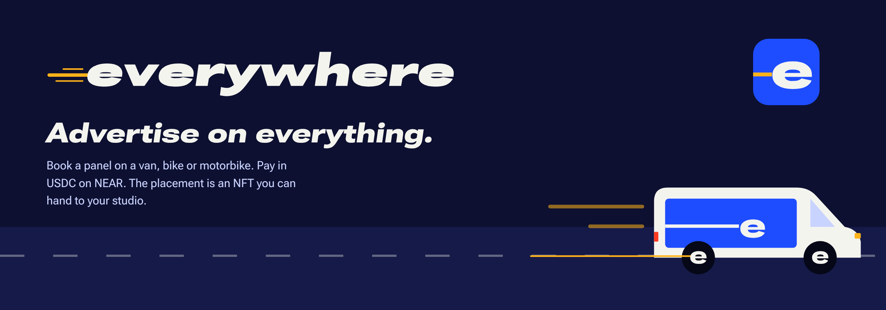
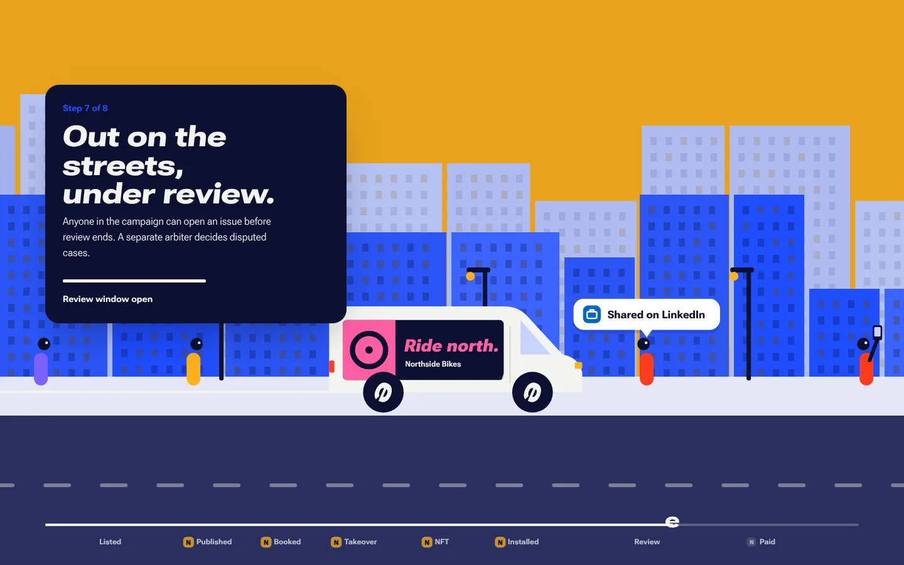
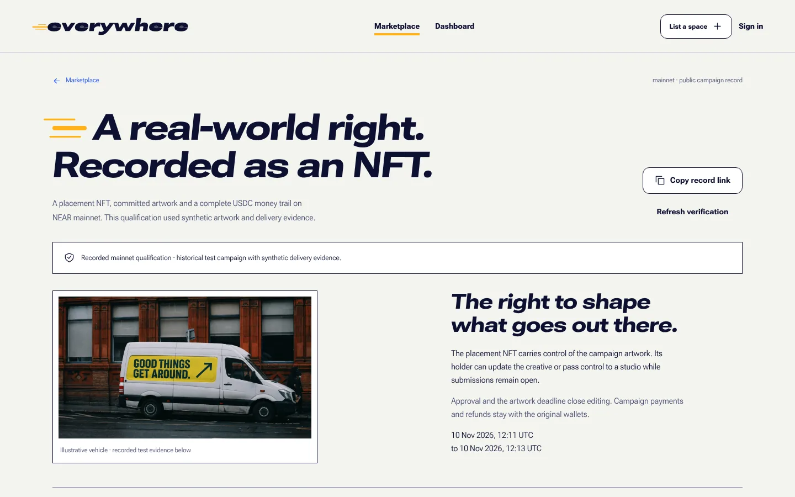
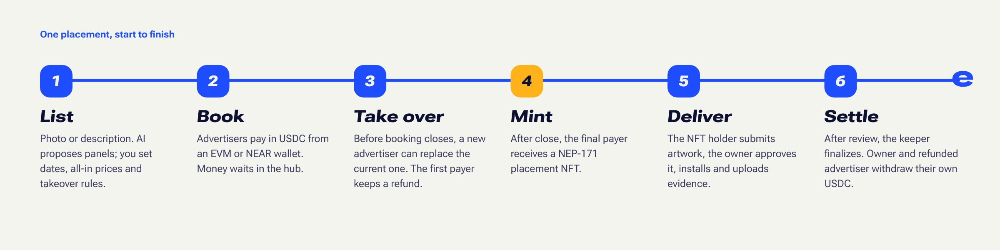
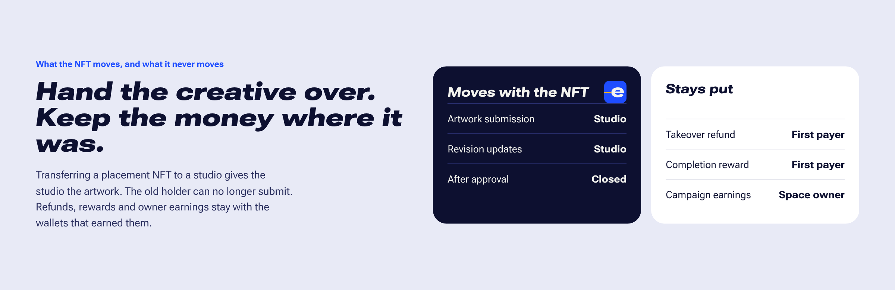

<p align="center"></p>

<p align="center">
<a href="https://everywhere-near.vercel.app">Live app</a> ·
<a href="https://everywhere-near.vercel.app/records/e22dd301-786f-476c-af74-0df7cd2e6168">Mainnet campaign record</a> ·
<a href="#verify-in-5-minutes">Verify in 5 minutes</a> ·
<a href="#hackathon-tracks">Hackathon tracks</a> ·
<a href="deployments/mainnet.json">Deployment manifest</a>
</p>

Everywhere is a marketplace for advertising on things that already move through a city. The first surfaces are vehicles. An owner photographs or describes a van, bike or motorbike; NEAR AI proposes the advertising panels; the owner sets campaign dates, all-in prices (printing and installation included) and whether a panel can be taken over. Advertisers book in USDC from an EVM or NEAR wallet.

When booking closes, the final advertiser receives the placement as a NEP-171 NFT. Whoever holds that NFT controls the artwork until the owner approves a revision, so an advertiser can send it to a design studio and the studio takes over the creative. The money stays put: refunds, takeover rewards and the owner's earnings are owed to the wallets that paid or earned them.

All of this runs on NEAR mainnet today, on one shared marketplace contract. A completed qualification campaign moved real USDC through every step (its artwork and installation evidence were synthetic), and four team-run vehicle listings are live on the same contract, three of them still taking bookings.

<table>
<tr>
<td width="50%"></td>
<td width="50%"></td>
</tr>
<tr>
<td>The homepage tells the whole lifecycle as one scrolling street scene.</td>
<td>Every campaign has a public record that anyone can check against the chain.</td>
</tr>
</table>

## Hackathon tracks

| Track | What Everywhere implements |
| --- | --- |
| NFTs That Do Something (`nfts`) | A NEP-171 placement NFT carries creative access rights. Its metadata follows each artwork revision (a dynamic NFT). Transferring it moves creative authority and leaves every financial claim where it was; owner approval locks the artwork before printing. |
| Real-World Money (`realworld`) | USDC payments for a physical service, EVM signing through NEAR Intents, recoverable claims, native withdrawals and quoted Base funding routes. |
| Open Innovation (`open`) | Booking rights on physical surfaces, takeovers before production with refunds to the original payer, completion rewards, and settlement anyone can inspect. |

The [NFT track brief](https://github.com/nearai/near-hackathon-prompt-examples/blob/main/tracks/10-nfts.md) asks for dynamic NFTs, NEP-171, sub-accounts and assets that carry access rights. Everywhere implements the first two and the access rights. Offers live in one shared hub contract, without a sub-account per NFT, which keeps deployment and storage costs down. An NFT is not a NEAR account and holds no funds.

## How a placement works

<p align="center"></p>

1. The owner creates a listing from a photo or a description, adjusts the suggested panels and publishes an offer per panel with dates, an all-in price and a takeover setting.
2. Advertisers book under those rules and pay in USDC. A buyer campaign can hold placements from several owners, each booked on its own.
3. On panels that allow it, a new advertiser can take over before booking closes. The displaced advertiser can claim their refund, plus a reward if the campaign completes.
4. When booking closes, the hub mints the placement NFT directly to the final payer, including EVM wallets.
5. The NFT holder submits artwork. The owner approves one exact revision, which locks editing, then prints, installs and uploads evidence. Anyone in the campaign can open an issue before review ends, and a separate arbiter decides disputed cases.
6. After service and review, a background keeper finalizes success if the artwork is locked, evidence exists and no issue is open. The owner and any displaced advertiser each withdraw their own USDC.

The NFT is the right to manage one placement's artwork for one campaign. It is separate from owning the vehicle, and it does not prove an installation: that evidence comes from the owner, and disputes need human judgement. The app shows no impressions, GPS routes or exposure figures, because it measures none.

## The NFT idea

<p align="center"></p>

A placement NFT is a transferable, time-limited right to manage the creative for one physical surface in one campaign. Its holder can submit or replace artwork until the owner approves a revision or the artwork deadline passes. Each new revision updates the NFT's IPFS reference and content hash.

Send the NFT to an agency and the agency can submit artwork; the previous holder is rejected. Once the artwork is approved, editing is closed for good, and transferring the NFT later cannot reopen it. The NFT stays as the campaign's record.

Money was kept off the NFT on purpose. If transferring the creative right also moved the advertiser's refund or the owner's earnings, every handoff to a studio would be a payment. The hub tracks those credits by original wallet.

This is live on mainnet. The Berlin van's cargo-panel NFT was [transferred to a studio](https://nearblocks.io/txns/DbHN9bSg6J2Q72ocWBUjMnEsk7VSTy5btqm7W63crMdB): the former holder's artwork submission was rejected, the studio's was accepted, and the financial credits were the same before and after. The Sandbox qualification checks the same boundary.

## Verify in 5 minutes

You need Node.js 22.23 or newer and npm; Node 22.23 and 24.12 both pass (the production image is pinned to 24.12). No wallet keys or funds are needed. From the repository root:

```sh
# Offline: no npm install, no network.
node backend/bin/verify-evidence.mjs --offline
# Expected: "status": "offline-verified", three files, "chainVerification": "not-performed".

npm ci --prefix backend --ignore-scripts
npm ci --prefix prototype --ignore-scripts
npm test --prefix backend      # Expected: 248 pass, 0 fail.
npm test --prefix prototype    # Expected: 97 pass, 0 fail.

npm run build:lab --prefix backend
npm run build --prefix prototype
npm start --prefix backend     # Expected: Everywhere API listening on port 4318.
```

Open http://127.0.0.1:4318. A fresh checkout serves the app with execution switched off and an empty local workspace. Live inventory is on the [hosted marketplace](https://everywhere-near.vercel.app/explore); publishing, payments and AI need configured services.

Then check the chain itself, in a second terminal:

```sh
node backend/bin/verify-evidence.mjs
# Expected when an RPC is reachable: "status": "verified", mainnet, 11 verified steps.

node backend/bin/verify-evidence.mjs https://archival-rpc.mainnet.near.org   # one specific RPC
node backend/bin/verify-team-campaigns.mjs                                   # the four team vehicles
```

The verifier tries `near.drpc.org`, `free.rpc.fastnear.com` and `archival-rpc.mainnet.near.org` in turn, read-only and with timeouts. Old transactions sometimes need an archival endpoint. If every endpoint fails it exits with `Network access to a NEAR mainnet RPC is required. Retry with: node backend/bin/verify-evidence.mjs <rpc-url>`. A custom URL turns off the fallbacks, and its path and query are kept out of the logs. It never loads credentials or signs anything.

Offline mode hashes the committed WASM, artwork and delivery files and compares them with the NEAR code hash, the raw IPFS CIDs and the manifest. It fails if a file is missing or changed. It does not fetch receipts, read current chain state, prove a physical installation or show that today's source rebuilds the deployed binary. See [evidence provenance](deployments/evidence/README.md).

### A short tour of the live app

1. In Marketplace, open a vehicle, pick its placements and look at the dates, prices and booking or takeover state. You don't have to pay.
2. Connect a wallet, open Dashboard and add a vehicle photo or description. Drag, resize and delete the proposed panels, then undo. A draft allocates no NEAR; AI suggestions need the provider to be up.
3. Open the [completed mainnet record](https://everywhere-near.vercel.app/records/e22dd301-786f-476c-af74-0df7cd2e6168) for the NFT, artwork, fulfilment commitments and payouts to the original wallets. The payments are real; the artwork and installation evidence are synthetic.

A real takeover uses a live listing's "Take over this spot" action, a second wallet and a real USDC payment before booking closes. To run the full lifecycle without public funds, use the [production-interface Sandbox qualification](backend/README.md#production-interface-on-near-sandbox).

## Live on mainnet

The [qualification record](https://everywhere-near.vercel.app/records/e22dd301-786f-476c-af74-0df7cd2e6168) has 11 receipts: 3¢ received, 3¢ withdrawn to the original creditors, nothing pending. The [deployment manifest](deployments/mainnet.json) pins the hub account and its code hash.

Four team-run listings sit on the same hub. Their photos are AI-generated references, payments are nominal amounts of real USDC, and checkout asks the buyer to confirm that nothing physical will be delivered. Cards, checkout and records all carry that label, and the images and prompts are credited in [ASSETS.md](prototype/public/ASSETS.md).

| Vehicle | Setup | Open |
| --- | --- | --- |
| Bucharest sport motorcycle | Side fairing and tail panel from 1¢ each; the tail panel is fixed booking | [Listing](https://everywhere-near.vercel.app/spaces/0627cf2a-28ad-4952-a16f-6b9fdfdbbe87?sale=2c541941-6d2f-4cf2-8cad-375cf4ad43ff) |
| Lisbon blue hatchback | Door-panel takeover from 2¢; rear door from 1¢ | [Listing](https://everywhere-near.vercel.app/spaces/7aec3544-317c-494c-adc2-cab5d510aa17?sale=59fca18a-6594-4591-a241-593c2604d76e) |
| Berlin workshop van | Cargo-panel NFT sent to a studio, which submitted artwork; cab door from 1¢ | [NFT record](https://everywhere-near.vercel.app/records/aa80efd3-472d-4e64-b8f8-fec738d2d3e2), [cab door](https://everywhere-near.vercel.app/spaces/3918c8f2-3263-4dfa-971e-02d6d13a6af3?sale=dc7a970a-a0b9-4664-8f7b-e4845a71c007&spot=spot-2) |
| Amsterdam cargo bicycle | Completed with synthetic delivery: 3¢ in, 3¢ paid out | [Record](https://everywhere-near.vercel.app/records/fbc318d7-414a-4a2f-ab26-5270c4d7f905) |

Booking stays open for the motorcycle, the hatchback and the van's cab door until 19 November 2026, 12:00 UTC, subject to live chain state. Each listing shows its service and review dates. Several placements on one vehicle are grouped on its page, and choosing one keeps that offer's own sale, terms, price, contract and checkout.

The [team campaign manifest](deployments/team-campaigns.json) records the seven published offers, image digests, setup transactions, the van's NFT transfer and the cargo bike's payouts. It leaves out keeper mint, finalization and reserve-reclaim transactions that the setup journal did not capture. `verify-team-campaigns.mjs` checks the offers, the extra placement receipts, current NFT ownership and artwork reference, the van handoff, the cargo bike's accounting and both payout transactions. Ownership and availability can change as people use the platform.

A real pilot is planned on the team's own motorcycle. Its [setup page](https://everywhere-near.vercel.app/host/assets/new?pilot=motorcycle) has editable Honda CBR600F2 details and downloadable vector artwork, and saves, publishes and pays nothing on its own. The owner still has to confirm the actual bike, panel, dimensions, city and schedule, upload a current photo and, later, real installation evidence. Until then the public qualification stays labelled synthetic.

## Why NEAR

| Part | What it does here |
| --- | --- |
| Shared marketplace hub | Offer accounting, takeover rules, escrow credits, placement NFTs, artwork commitments and the fulfilment and issue gates, in one contract |
| NEAR Intents | EVM-signed purchases and owner or advertiser actions, USDC balances and payouts to the original wallets |
| Base USDC and 1Click | Quoted funding and return routes for Base wallets, with reconciliation of transactions and delivery |
| Native NEAR wallets | NEP-413 sign-in and wallet-signed contract and token actions |
| API and SQLite | Inventory, buyer campaigns, sessions, media, conversations, operation journals and recovery |

People approve every signature and transfer in their own wallet, and signing in alone authorizes no spending. If a transaction is interrupted, the app checks the original recorded operation before it offers another transfer.

The hub still has an upgrade key. Hub administration and that key stay on a local machine, apart from the hosted relayer account. Code-hash pinning in the backend notices a changed deployment; it does not make the contract immutable.

## AI listing setup

After signing in, an owner can upload a vehicle photo, send one from a phone through a private QR link, describe the vehicle, or start from the labelled example van. NEAR AI proposes editable panel outlines; a description first generates a labelled reference image. Drafts are private and allocate no NEAR.

Try `/host/assets/new`, move a panel or type `Rename the first panel to Studio panel`, then continue to the offer screen to set the area, dates, prices and per-panel takeover rules. Publishing needs wallet approval and uses the existing hub; NFTs are minted at booking close. Free publication depends on the live sponsor pool and its limits.

The server reads `NEAR_AI_API_KEY` (development also accepts the owner-only `.env.local`). `NEAR_AI_MODEL` defaults to `z-ai/glm-5.3-flash` with minimal reasoning and `NEAR_AI_IMAGE_MODEL` to `black-forest-labs/FLUX.2-klein-4B`. Jobs have per-wallet and global limits, stable request IDs and stored results. A reload checks the original job, and paid inference is never retried automatically. Instructions change only what they name. Manual editing keeps working when the provider is down.

An opt-in benchmark runs up to 20 photos through the provider and writes a private latency and usage report:

```sh
node backend/bin/benchmark-vehicle-ai.mjs --run /path/to/manifest.json .local/vehicle-ai-report.json
```

Each manifest entry looks like `{"file":"/path/to/vehicle.jpg","prompt":"Suggest visible body panels"}`. It spends AI credits, touches no chain and makes no claim about measured dimensions or panel accuracy. The private AI companion connects only its owner's allowlisted wallets to that owner's local ChatGPT connection; those credentials never leave the owner's computer.

## Visual identity

The Kinetic identity grows from one mark: the crossbar of the e keeps going as a trail, the line a vehicle draws through the city. That line is the logo, the mark in front of page titles, the link underline and the progress bar, and in the homepage story every wheel is an e that leaves it behind. Roboto Flex (self-hosted, SIL OFL) sets all type, wide and slanted for display. The palette is night ink `#0D1030`, motion blue `#1E4DFF`, sodium yellow `#FFB21A` and paper `#F4F4EF`. Tokens are in [`identity.css`](prototype/src/identity.css), brand details in [`kinetic.css`](prototype/src/kinetic.css) and [`brand.mjs`](prototype/src/brand.mjs), and the story in [`story.mjs`](prototype/src/story.mjs). Credits are in [ASSETS.md](prototype/public/ASSETS.md).

## Repository map

| Path | Contents |
| --- | --- |
| [`prototype/`](prototype/README.md) | The connected web app (the folder name is historical) |
| [`backend/`](backend/README.md) | API, wallet adapter, keeper, verifiers and the Sandbox qualification |
| [`contracts/marketplace-hub/`](contracts/marketplace-hub/README.md) | The shared mainnet hub: offers, escrow, takeovers, placement NFTs, fulfilment |
| [`deployments/`](deployments/mainnet.json) | Mainnet manifests and hash-bound evidence |
| [`proofs/sandbox/`](proofs/sandbox/README.md) | Local-chain proofs |

## Tests

```sh
npm test --prefix backend
npm test --prefix prototype
npm run build --prefix prototype
node prototype/tests/startup-browser.mjs
node prototype/tests/judge-browser.mjs
node prototype/tests/spot-editor-browser.mjs
```

The browser suites run against isolated API fixtures. They cover desktop and mobile layouts, placement NFTs, evidence outages and retries, and the spot editor's mouse, touch and keyboard gestures, undo and redo, empty drafts and delayed-save recovery. They make no wallet or mainnet calls.

The [production browser qualification](backend/README.md#production-interface-on-near-sandbox) runs the real interface against an isolated NEAR Sandbox, the compiled hub and the pinned Intents verifier. It goes from an unfunded EVM owner through publication, several buyers, takeovers, rejected signatures, restart recovery, automatic minting, an EVM creative-control transfer with the former holder rejected, fulfilment, disputes, settlement, exact payouts and native USDC withdrawal. Its injected EIP-1193 wallet produces real signatures but does not drive a real extension's approval screen. Media-provider HTTP is isolated while the upload and digest checks run for real. Base routing and pinning-provider availability need their own qualification.

## Hosting

Production runs the [Docker image](Dockerfile) with the [Railway configuration](.railway/railway.ts): one instance and a persistent SQLite volume, with HTTPS origins and server secrets set explicitly. A static frontend deployment also needs the API and wallet-adapter routes. Setup is in the [backend README](backend/README.md#production-hosting). Wallet keys, local credentials, state databases and private test reports are kept out of the repository; the public qualification manifest and its three evidence files are committed.

## Where it came from

Everywhere grew out of the team's earlier Pitboard idea for vehicle sponsorship with takeovers. This repository holds the Everywhere application, its wallet integration, the NEAR contracts, the shared hub and the verification suites; we don't present the earlier concept as new. The static marketplace prototype starts at [46483c9](https://github.com/MihRazvan/near_hackathon/commit/46483c9) and the NEAR contract work at [ae3efa1](https://github.com/MihRazvan/near_hackathon/commit/ae3efa1), so the history shows the path from prototype to connected platform.
