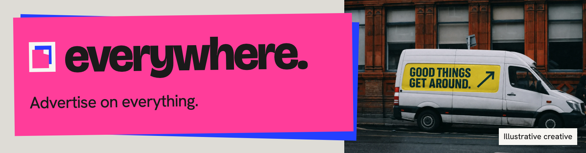
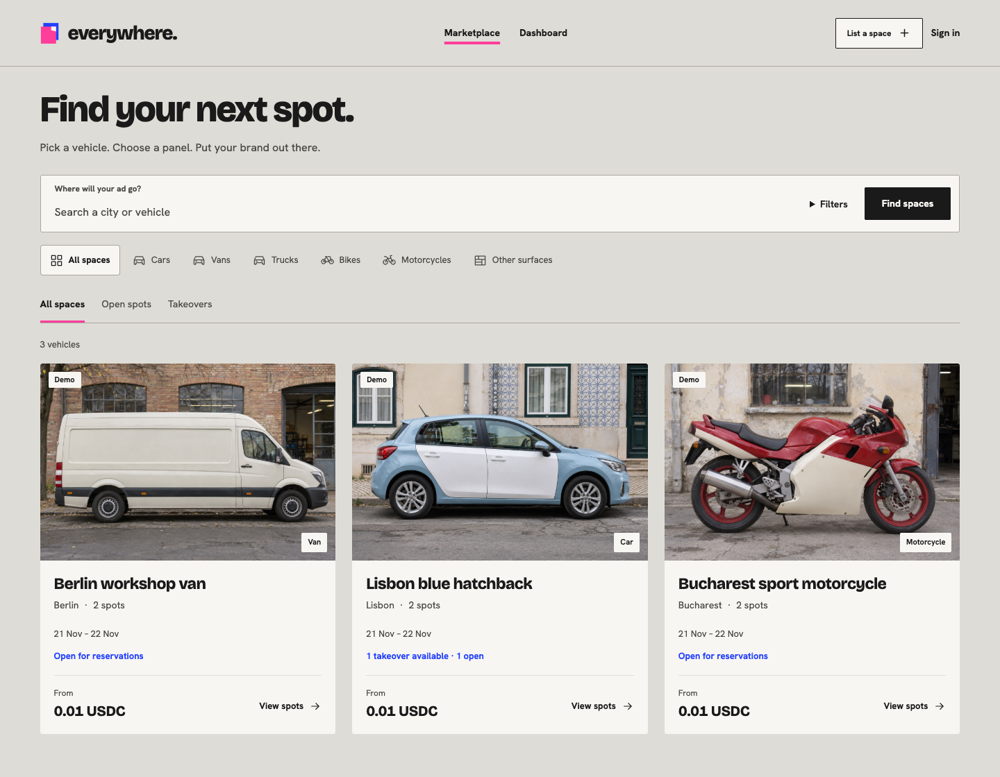
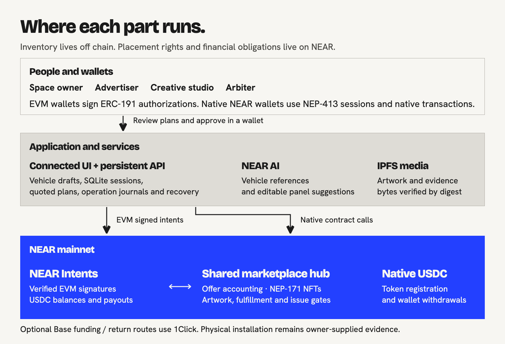

# Everywhere



Everywhere is a marketplace for physical ad space, starting with vehicles. Owners list panels from a photo or description; advertisers reserve them in USDC or take over a booking before production. After booking closes, the final advertiser receives a **NEAR placement NFT** that controls artwork access.

[Live platform](https://everywhere-near.vercel.app/) | [Demo video (coming soon)](docs/DEMO.md#demo-video) | [Project brief](docs/PROJECT-BRIEF.md)

[Quickstart](#verify-in-5-minutes) | [User flow](docs/USER-FLOW.md) | [Technical architecture](docs/TECHNICAL-ARCHITECTURE.md) | [Contracts](docs/CONTRACTS.md) | [Verify](VERIFY.md) | [Docs](docs/README.md)

[](https://github.com/MihRazvan/near_hackathon/actions/workflows/verify.yml) [](LICENSE)

## Problem first

An owner has room for an ad on their van. A business wants to book it, and a studio may handle the design. They need to agree on the panel, campaign dates and price, but also who can change the artwork and when the owner gets paid.

Everywhere records the placement's terms on NEAR. A takeover can replace the advertiser before printing, and an NFT transfer can hand artwork control to a studio. Refunds stay with the wallet that paid; delivery and review must finish before the owner can claim earnings.

[](https://everywhere-near.vercel.app/explore)

*Public marketplace with team-run campaigns. The vehicle images are generated and payments use real USDC. Delivery evidence is synthetic; no ads were installed for these tests.*

## Overview

- Owners start with a photo or description. NEAR AI suggests panels they can move, resize, reshape, duplicate or delete before setting dates, all-in prices and takeover rules.
- Advertisers book individual placements in USDC. If takeovers are enabled, a new buyer can replace the current advertiser before booking closes. The displaced payer keeps their refund and any conditional reward.
- The final advertiser receives a NEP-171 placement NFT after booking closes. Sending it to a studio gives that studio artwork access. Refunds, rewards and earnings stay with their original wallets.

[](docs/USER-FLOW.md#space-owner)

*The working editor with fixture data. This capture used no paid AI call, wallet connection or transaction.*

## The NFT is the control layer

A placement NFT gives its holder artwork access for a specific surface and campaign. The contract checks who holds it before accepting a submission.


The NFT has dynamic metadata: each artwork revision updates its IPFS reference and content hash. The owner approves and locks one revision for production. Editing ends at approval or the artwork deadline, and later transfers cannot reopen it.

Offers share one hub; individual NFTs have no sub-accounts or money of their own. A studio can receive artwork rights while the advertiser keeps their refund and the owner keeps their earnings. The NFT grants no ownership of the vehicle and does not verify installation.

[Inspect the recorded mainnet NFT handoff](https://everywhere-near.vercel.app/records/aa80efd3-472d-4e64-b8f8-fec738d2d3e2) | [Read the authority and accounting rules](docs/CONTRACTS.md)

## How it works


1. The space owner reviews the vehicle's spots and publishes fixed campaign dates. Prices include printing and installation.
2. An advertiser reserves a placement or takes it over under the published rules before booking closes.
3. The final NFT holder submits artwork or transfers creative control to a studio during the editing window.
4. The owner approves the exact revision, arranges installation and submits evidence. Participants can raise an issue; a separate arbiter resolves disputes.
5. After service and review end, the contract checks the delivery requirements before settling the campaign. Each wallet owed USDC can claim and withdraw its funds.

One buyer campaign can contain placements from multiple owners; each placement remains independently booked and accounted for. [Follow both sides of the platform](docs/USER-FLOW.md).

## Tech stack

| Layer | Technology | What it does |
| --- | --- | --- |
| Placement rights and settlement | **Rust, NEAR SDK, NEP-171** | Shared-hub offer accounting, takeovers, dynamic NFTs, artwork and fulfillment gates |
| Wallets and payments | **NEAR Intents, ERC-191, NEP-413** | EVM-signed actions, native NEAR sessions, USDC credits and original-wallet payouts |
| Cross-chain funding | **Base USDC + 1Click** | Quoted funding/return routes and delivery reconciliation |
| Vehicle setup | **NEAR AI** | Photo analysis, generated references and editable panel suggestions |
| Media | **IPFS, SHA-256, sharp** | Public-content consent and verified artwork/evidence bytes |
| Application | **JavaScript ES modules, Vite, Node.js, SQLite** | Responsive frontend, durable API, sessions, operation journals and recovery |
| Qualification | **Node tests, Rust tests, Playwright, axe-core, NEAR Sandbox** | Clean-checkout checks and a real local-chain interface lifecycle |

[](docs/TECHNICAL-ARCHITECTURE.md)

The UI and inventory are off chain. Rights, creditor accounting and settlement rules are enforced on NEAR. The hub retains an upgrade key; physical evidence and disputes still require human judgment. [Trust boundaries and source map](docs/TECHNICAL-ARCHITECTURE.md#trust-boundaries).

## Hackathon tracks

| Track | Implemented contribution | Inspect |
| --- | --- | --- |
| **NFTs That Do Something** (`nfts`) | NEP-171 ownership, dynamic metadata and transferable creative access rights, with original-creditor separation | [NFT behavior](docs/CONTRACTS.md#nft-authority) |
| **Open Innovation** (`open`) | Physical advertising rights, pre-production takeovers and independently inspectable campaign settlement | [Project brief](docs/PROJECT-BRIEF.md) |
| **Real-World Money** (`realworld`) | USDC service payments, recoverable claims, EVM authorization through Intents and native withdrawals | [Payment path](docs/TECHNICAL-ARCHITECTURE.md#payment-and-recovery) |

[Track briefs and implementation evidence](docs/PROJECT-BRIEF.md#hackathon-fit).

## Verify in 5 minutes

Use **Node.js 22.23+** and npm. No wallet, API key or funds are needed:

```sh
node scripts/verify.mjs
```

The command installs locked dependencies, runs **260 backend, 97 frontend and 17 verification tests**, then builds the wallet adapter and frontend. It starts an isolated API, checks its endpoints and stops it. Dependency downloads need network access; the report lists the checks and their results.

```sh
node scripts/verify.mjs --offline  # Checks committed hashes without dependencies or network.
npm start --prefix backend        # After the quick build: opens the app on port 4318.
```

Open **http://127.0.0.1:4318**. A fresh checkout has an empty workspace with transactions disabled. The [hosted marketplace](https://everywhere-near.vercel.app/explore) has published inventory. AI, publication and payments each need their configured services; running the quick check leaves them disabled.

The [public CI](https://github.com/MihRazvan/near_hackathon/actions/workflows/verify.yml) tests Node 22.23/24.12 and the desktop/mobile UI, including accessibility. macOS arm64 rebuilds the exact deployed WASM. Linux runs the lifecycle on a local chain using the hash-checked deployed binary: **32 checks and 23 genuine EVM signatures**, including a rejected former-holder request and the same request succeeding for the current holder. The run ends with zero liabilities or pending withdrawals.

[All verification modes, commands and boundaries](VERIFY.md) | [Pinned source rebuild](BUILD.md)

## Deployments and evidence

| Record | What to inspect |
| --- | --- |
| [Shared mainnet hub](https://nearblocks.io/address/8a97f02b08b964bb618031529dfacf8cb4f922ddc646ef525c4d68355f81be20) | Contract shared by independently accounted placements; [deployment manifest](deployments/mainnet.json) |
| [Completed mainnet qualification](https://everywhere-near.vercel.app/records/e22dd301-786f-476c-af74-0df7cd2e6168) | Purchase, takeover, final NFT, synthetic delivery and original-wallet payouts |
| [Van NFT handoff](https://everywhere-near.vercel.app/records/aa80efd3-472d-4e64-b8f8-fec738d2d3e2) | Creative control transferred to a studio; financial creditors retained |
| [Seven published team offers](deployments/team-campaigns.json) | Motorcycle, hatchback and van placements, plus a completed cargo-bike campaign |

The recorded campaigns used real payments and synthetic artwork/delivery evidence. The motorcycle pilot still needs installation and evidence. Fresh receipt verification depends on RPC availability; offline hashes only check the committed files. [Deployment status and campaign records](docs/DEPLOYMENTS.md).

## Documentation

[Project brief](docs/PROJECT-BRIEF.md) · [User flow](docs/USER-FLOW.md) · [Technical architecture](docs/TECHNICAL-ARCHITECTURE.md) · [Contracts](docs/CONTRACTS.md) · [Verification](VERIFY.md) · [Build](BUILD.md) · [Deployments](docs/DEPLOYMENTS.md) · [Demo & submission links](docs/DEMO.md) · [Docs index](docs/README.md)

Everywhere builds on the earlier **Pitboard** sponsorship concept and takeover idea. The [project brief](docs/PROJECT-BRIEF.md#what-was-built-here) links the implementation history. The team used Codex and Claude during development; the app uses NEAR AI for vehicle setup. The optional personal subscription companion runs on its owner's computer.

Original code is licensed under [MIT](LICENSE), copyright Everywhere contributors. Third-party assets and dependencies retain their licenses: [application asset credits](prototype/public/ASSETS.md), [documentation visual provenance](docs/assets/README.md), [backend lockfile](backend/package-lock.json), [frontend lockfile](prototype/package-lock.json), [Rust lockfile](Cargo.lock).

Built for [NEAR HACKATHON](https://nearhackathon.com/).
