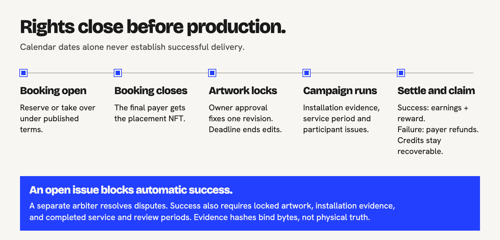
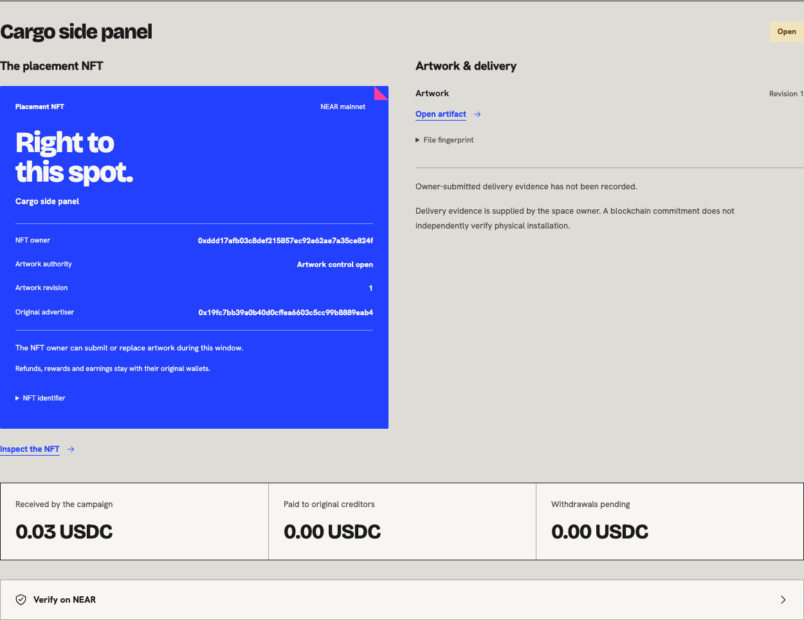

# Contracts and placement rights

[Overview](../README.md) | [Project brief](PROJECT-BRIEF.md) | [User flow](USER-FLOW.md) | [Architecture](TECHNICAL-ARCHITECTURE.md) | [Verify](../VERIFY.md) | [Docs](README.md)

The shared NEAR marketplace hub handles each offer's terms and accounting. Its placement NFTs determine who can submit campaign artwork. New vehicle listings use the same contract.

| Identity | Link |
| --- | --- |
| Current source | [`contracts/marketplace-hub/src/lib.rs`](../contracts/marketplace-hub/src/lib.rs) |
| Current unit assertions | [`contracts/marketplace-hub/src/tests.rs`](../contracts/marketplace-hub/src/tests.rs) |
| Mainnet account | [`8a97…be20`](https://nearblocks.io/address/8a97f02b08b964bb618031529dfacf8cb4f922ddc646ef525c4d68355f81be20) |
| Deployment and token configuration | [`deployments/mainnet.json`](../deployments/mainnet.json) |
| Pinned source/deployment build | [`BUILD.md`](../BUILD.md), [`deployments/build.json`](../deployments/build.json) |

The older marketplace, campaign and factory crates contain earlier experiments, including the old recipient-nomination flow. [Contract directory guide](../contracts/README.md).

## Lifecycle



| Phase | Permitted behavior | Relevant gate |
| --- | --- | --- |
| Published / booking open | Purchase and enabled takeover under the committed offer terms | Expected round, price, identity and booking cutoff |
| Booking closed / creative window | Mint the final NFT directly to the final payer; submit artwork or transfer creative control | Current holder and artwork window |
| Approved or deadline reached | Owner approval fixes a revision; deadline independently ends editing | A token transfer cannot reopen editing |
| Installation / service / review | Commit installation evidence and raise participant issues in the allowed period | Evidence revision, deadlines and participant authority |
| Settlement | Permissionless success only after all success gates; designated arbiter handles disputed/failure outcomes | No unresolved issues, required fulfillment and completed service/review |
| Claims / withdrawal | Original creditors claim; withdrawal callbacks reconcile actual transfer outcomes | No duplicate credit, no redirection or cross-offer spending |

An unbooked offer has a separate closure path. Once all financial obligations settle, the original funder can reclaim the storage reserve. NFT transfers leave that entitlement with the funder.

## NFT authority

The hub implements NEP-171 ownership and transfer. Artwork revisions update token metadata, and the current holder has creative access during the editing window. Tokens share the hub contract and have no separate sub-accounts.

- The final payer receives the placement token after booking closes, including an EVM payer.
- Artwork authorization uses the current placement owner. Once minted, the NFT holder is the authority.
- Each submitted artwork revision updates the token metadata's IPFS reference and content hash.
- The space owner approves one exact revision for production. Approval or the artwork deadline ends editing.
- Transfer changes the creative controller during the active window; a later archival transfer cannot restore expired authority.
- `nft_transfer_call` is restricted while artwork rights are active. Ordinary token transfer is still subject to the hub's placement rules.

Relevant implementation symbols include `placement_owner`, `artwork`, `transfer_placement`, `nft_transfer`, `nft_token` and `mint_final_placement` in the [current source](../contracts/marketplace-hub/src/lib.rs).



*Public mainnet team-test record. Its generated reference and synthetic delivery do not establish a physical installation. The screenshot records UI state at capture time; open the [live record](https://everywhere-near.vercel.app/records/aa80efd3-472d-4e64-b8f8-fec738d2d3e2) for a current check.*

### Executable authority checks

```sh
cargo test --locked -p marketplace-hub --lib
```

The active-window tests `former_payer_cannot_submit_artwork_after_nft_transfer_during_active_window` and `transferred_nft_owner_revises_active_artwork_without_receiving_original_creditors_money` separately prove rejection and new-holder revisions, metadata updates and unchanged creditors.

The [local-chain browser scenario](../prototype/tests/production-browser.mjs) also sends a request past the UI/API checks: former holder B signs a direct Intents artwork request, which fails in a hub receipt. Current holder A signs the same action, deadlines and gas parameters with a fresh nonce and succeeds. A then submits verified UI artwork revision 2; B receives control back and submits revision 3, which the owner approves and the delivery proof references.

Optimized WASM can report rejection as a trap, hiding the panic message. The matched positive request establishes payload/gas validity, while the Rust unit test separately asserts the exact `placement owner only` rejection. The direct control artifact is synthetic and unpinned; later UI artifacts are digest-verified. [Reports and coverage boundaries](../VERIFY.md#full-interface-on-a-local-chain).

## Financial claims stay with original wallets

| Claim | Creditor | Does NFT transfer move it? |
| --- | --- | --- |
| Displaced payment refund | Original displaced payer | No |
| Conditional completion reward | Original eligible displaced payer | No |
| Failed-campaign refund | Original entitled payer | No |
| Successful campaign earnings | Space owner | No |
| Reclaimable offer storage reserve | Original reserve funder | No |

Giving a studio creative control leaves the advertiser's refund and the owner's earnings with their original wallets. The token holds no funds and is not a NEAR account; the Intents balance and hub liabilities follow the offer's accounting rules.

Withdrawal state and callbacks preserve pending principal, prevent duplicate credit and retain creditor identity when transfers fail or must be reconciled. See `start_withdrawal`, `on_withdrawal` and the callback/independent-offer tests in the [hub test suite](../contracts/marketplace-hub/src/tests.rs).

## Fulfillment, disputes and trust

Elapsed time alone cannot prove physical delivery. Successful settlement requires the configured service/review periods, locked artwork, installation evidence and no unresolved issue. Participants can open issues; a separate configured arbiter resolves disputed cases. Evidence hashes identify the submitted bytes. The arbiter judges the physical delivery.

The hub retains an upgrade key. Backend code-hash pinning detects a changed deployment but does not make it immutable. These tests and source checks are not an external security audit. [Trust boundaries](TECHNICAL-ARCHITECTURE.md#trust-boundaries) and [evidence provenance](../deployments/evidence/README.md) remain part of the implementation description.
