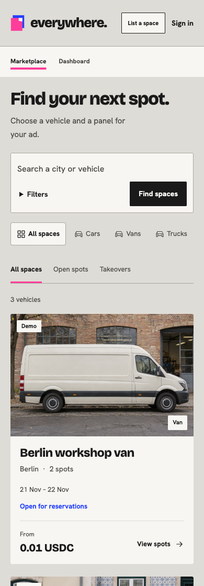

# Demo and submission links

[Overview](../README.md) | [Project brief](PROJECT-BRIEF.md) | [User flow](USER-FLOW.md) | [Architecture](TECHNICAL-ARCHITECTURE.md) | [Verify](../VERIFY.md) | [Docs](README.md)

## Demo video

[Watch Everywhere's NEAR Hackathon demo on YouTube](https://www.youtube.com/watch?v=I97CLb9dDhY).

## Public demo post

[Read the public demo post on X](https://x.com/magentoooo/status/2121736153464512781).

## Inspect the product now

| Do this | See this |
| --- | --- |
| Open [Marketplace](https://everywhere-near.vercel.app/explore), choose a vehicle and select another placement | The image outline, selected spot, dates, price and reserve/takeover action stay bound to that offer. No payment is required to inspect it. |
| Sign in and open [vehicle setup](https://everywhere-near.vercel.app/host/assets/new?mode=photo) | Add a photo or description, review suggested spots and edit their geometry. Suggestions require an available AI provider; drafts allocate no NEAR. |
| Open the [recorded NFT handoff](https://everywhere-near.vercel.app/records/aa80efd3-472d-4e64-b8f8-fec738d2d3e2) | Inspect the studio's creative right, artwork commitment and original financial creditors. Fresh verification may be unavailable during provider outages. |
| Open the [completed qualification](https://everywhere-near.vercel.app/records/e22dd301-786f-476c-af74-0df7cd2e6168) | Follow a real mainnet purchase/takeover/NFT/settlement record, with synthetic artwork and delivery labelled. |
| Run `node scripts/verify.mjs` | Locked install, current tests, builds and isolated startup pass without keys or funds. |

*Public site on a phone. The generated vehicle images belong to team tests; no physical ads were installed for them.*

## Submission references

The current [official instructions](https://nearhackathon.com/HACKATHON.md) require a public repository and a public X demo post identifying NEAR HACKATHON, tagging `@NEARProtocol` and `#NEARHackathon`, with video or screenshots attached. Both links go in the [submission form](https://nearhackathon.com/#apply). A local-only demo requires video. The published deadline is **14 November 2026, 23:59 UTC** (**15 November, 01:59 in Bucharest**). The live instructions contain the current rules.

The submission needs both published links. Personal contact details and the final payload stay outside this repository. See the [three track claims](PROJECT-BRIEF.md#hackathon-fit), [MIT license](../LICENSE) and baseline disclosure for the project details.
