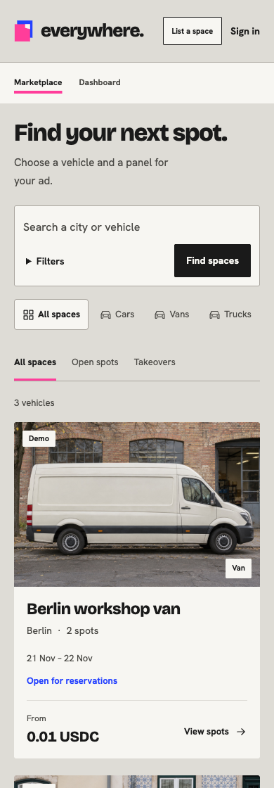

# Demo and submission links

[Overview](../README.md) | [Project brief](PROJECT-BRIEF.md) | [User flow](USER-FLOW.md) | [Architecture](TECHNICAL-ARCHITECTURE.md) | [Verify](../VERIFY.md) | [Docs](README.md)

## Demo video

**Coming soon.** Replace this placeholder with the published video link and a real thumbnail when the recording is ready. No completed video is implied by this page.

## Public demo post

**Coming soon.** The team's public X post link belongs here after publication. This documentation update does not submit the project or publish a social post.

## Inspect the product now

| Do this | See this |
| --- | --- |
| Open [Marketplace](https://everywhere-near.vercel.app/explore), choose a vehicle and select another placement | The image outline, selected spot, dates, price and reserve/takeover action stay bound to that offer. No payment is required to inspect it. |
| Sign in and open [vehicle setup](https://everywhere-near.vercel.app/host/assets/new?mode=photo) | Add a photo or description, review suggested spots and edit their geometry. Suggestions require an available AI provider; drafts allocate no NEAR. |
| Open the [recorded NFT handoff](https://everywhere-near.vercel.app/records/aa80efd3-472d-4e64-b8f8-fec738d2d3e2) | Inspect the studio's creative right, artwork commitment and original financial creditors. Fresh verification may be unavailable during provider outages. |
| Open the [completed qualification](https://everywhere-near.vercel.app/records/e22dd301-786f-476c-af74-0df7cd2e6168) | Follow a real mainnet purchase/takeover/NFT/settlement record, with synthetic artwork and delivery explicitly identified. |
| Run `node scripts/verify.mjs` | Locked install, current tests, builds and isolated startup pass without keys or funds. |

*Mobile capture from the public site. The listed generated vehicles are team tests, not independently proven physical ad installations.*

## Suggested recording sequence

A two-to-three-minute walkthrough is a team presentation plan, not an organizer-imposed video duration.

1. Start with a vehicle photo or description and show editable spots, then the campaign offer. Make the owner action and its visible result clear.
2. Select a real published placement, reserve it, and show a distinct buyer's takeover before booking closes. Label real USDC, required wallet approvals and any accelerated/local scenes accurately.
3. Show the final placement NFT and hand creative control to a studio. Demonstrate that the studio can submit artwork while the original wallets retain financial claims.
4. Show approval, installation evidence and settlement. Synthetic evidence is not a genuine installation; include actual motorcycle footage only after it exists.
5. End on the public record and verification path rather than a long architecture slide.

## Submission references

The current [official instructions](https://nearhackathon.com/HACKATHON.md) require a public repository and a public X demo post identifying NEAR HACKATHON, tagging `@NEARProtocol` and `#NEARHackathon`, with video or screenshots attached. Both links go in the [submission form](https://nearhackathon.com/#apply). A local-only demo requires video. The published deadline is **14 November 2026, 23:59 UTC** (**15 November, 01:59 in Bucharest**); recheck the live rules before submission.

The README's video and post placeholders must be replaced after the team publishes them. Personal submission details and the final payload belong outside this public repository. The platform's [three track claims](PROJECT-BRIEF.md#hackathon-fit), [MIT license](../LICENSE), baseline disclosure and reproducibility documentation are already linked.
