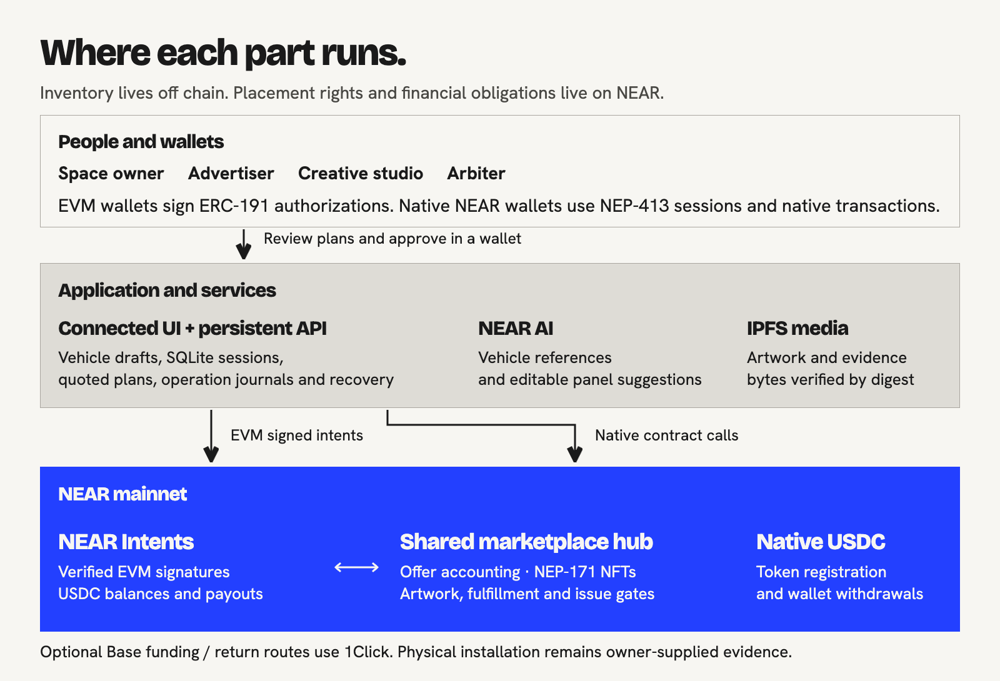
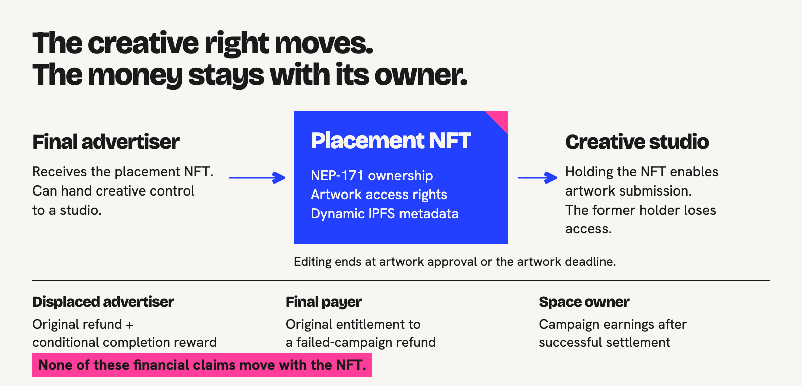

# Technical architecture

[Overview](../README.md) | [Project brief](PROJECT-BRIEF.md) | [User flow](USER-FLOW.md) | [Contracts](CONTRACTS.md) | [Verify](../VERIFY.md) | [Docs](README.md)

Everywhere presents a conventional marketplace while separating inventory and orchestration from NEAR-enforced placement rights and financial obligations. The current contract is the shared marketplace hub; the application frontend remains in the historically named `prototype/` directory.



## Components and source map

| Component | Responsibility | Source |
| --- | --- | --- |
| Connected frontend | Marketplace, photo/outline editor, checkout, dashboard, profile and public campaign records | [`prototype/src/integration`](../prototype/src/integration/), [frontend setup](../prototype/README.md) |
| Persistent API | Inventory, sessions, wallet plans, media, buyer campaigns, operation status and recovery | [`backend/src/product.mjs`](../backend/src/product.mjs), [backend setup](../backend/README.md) |
| SQLite | Durable application state and transaction journals; it is not the authority for on-chain ownership or payment finality | [`backend/src/store.mjs`](../backend/src/store.mjs) |
| Wallet authorization | NEP-413 native sessions; ERC-191 EVM authorization bound to the intended action | [`backend/src/auth.mjs`](../backend/src/auth.mjs), [`intents.mjs`](../backend/src/intents.mjs) |
| Shared hub | Per-offer terms, purchases, takeover credits, NFTs, artwork, fulfillment, issues and withdrawals | [`contracts/marketplace-hub/src/lib.rs`](../contracts/marketplace-hub/src/lib.rs) |
| NEAR Intents | Verify EVM signatures and execute authorized actions; maintain USDC balances and payouts | [`backend/src/intents.mjs`](../backend/src/intents.mjs), [`hub-actions.mjs`](../backend/src/hub-actions.mjs) |
| 1Click routing | Quote Base funding/return routes and reconcile deposit/delivery | [`backend/src/browser-funding.mjs`](../backend/src/browser-funding.mjs), [`customer-funding.mjs`](../backend/src/customer-funding.mjs) |
| NEAR AI | Propose editable panels from a photo; generate labelled vehicle references from descriptions | [`backend/src/asset-ai.mjs`](../backend/src/asset-ai.mjs) |
| Media | Consent, uploads, IPFS references and retrieved-byte digest checks | [`backend/src/media.mjs`](../backend/src/media.mjs) |
| Keeper / executor | Bounded relaying, reconciliation, eligible NFT minting and settlement | [`backend/src/near-executor.mjs`](../backend/src/near-executor.mjs), [`keeper.mjs`](../backend/src/keeper.mjs) |

The [lockfiles](../README.md#documentation) pin dependencies. Runtime AI and hosting configuration are described in [deployment details](DEPLOYMENTS.md#ai-and-hosting).

## From a vehicle to an offer

1. A signed-in owner creates a private vehicle draft from a photo, a private phone capture, a description or the labelled sample.
2. NEAR AI output becomes editable normalized geometry. The owner confirms the panel layout and dimensions rather than treating an AI guess as a manufacturing specification.
3. The owner creates a campaign with fixed dates, all-in prices and per-panel takeover rules. The API prepares a terms commitment and operation plan.
4. Wallet approval authorizes the actual publication. The shared hub binds each offer to its original listing and terms; sponsorship remains bounded by live balances and policy limits.
5. The application reconciles the result before marking publication confirmed. A saved private draft does not itself publish or allocate storage on NEAR.

## Payment and recovery

### EVM wallet

The application builds a specific intent plan. The user reviews it and signs an ERC-191 message. The relayer submits that signed intent to the configured NEAR Intents verifier; the verifier and hub enforce the actor, target offer, amount, expected state and committed terms. Relaying does not grant the server an unrestricted user spending key.

USDC already in the supported Intents balance can fund an action. Base funding uses a separate 1Click quote and wallet-approved transfer. Route costs, minimums, status and refunds belong to the provider's actual quote and observed delivery. The local-chain test does not establish a live Base route.

### Native NEAR wallet

NEP-413 authenticates the session. The wallet signs required contract or token actions. Native USDC withdrawal may first require token storage registration; the application checks the receiving account's state rather than treating a session as payment authorization.

### Durable operation recovery

[`wallet-requests.mjs`](../backend/src/wallet-requests.mjs) and the executor retain operation identity, signed-plan binding and transaction/delivery observations. A lost HTTP response is an unknown outcome to reconcile, not permission to authorize another transfer. The browser checks its original recorded operation after reload or restart.

The [original-intent tests](../backend/tests/original-intent-recovery.test.mjs), [provision-recovery tests](../backend/tests/provision-recovery.test.mjs) and [production Sandbox interface](../prototype/tests/production-browser.mjs) exercise these boundaries.

## NFT and media path



After booking closes, the final payer receives a NEP-171 token. The current holder controls artwork within its active window. Transferring the token changes creative authority without changing original financial creditors.

Artwork is stored as public content only with explicit consent. The media implementation verifies the retrieved bytes against their SHA-256. The hub commits the artifact URI/hash and revision, and dynamic token metadata follows the accepted artwork. Owner approval locks an exact revision. Installation evidence similarly commits submitted bytes and refers to the relevant approved artwork.

A CID, SHA-256 or NFT is not an independent oracle for physical installation. [Contract rules](CONTRACTS.md) and [human review flow](USER-FLOW.md#campaign-arbiter) describe the remaining authority.

## Trust boundaries

| Boundary | Enforced or retained | Remaining trust / limit |
| --- | --- | --- |
| Wallet → application | Session identity and explicit action approval | Real wallet-extension UI and response times belong to the provider. |
| Application → Intents / hub | Signed plan, offer terms, actor, expected round and financial amounts | Current hub has an upgrade key; clients pin code identity, but the contract is not immutable. |
| NFT transfer → creditors | Original refund/reward/earnings ownership remains fixed | NFT custody grants creative access only within the permitted window. |
| Database → chain | Application journals reconcile actual outcomes | Inventory, presentation and orchestration remain off chain. |
| Media → physical service | Exact submitted bytes and approval revision are committed | Owner evidence and disputed delivery need human judgment. |
| Keeper → settlement | Success is constrained by service/review times, locked artwork, evidence and no unresolved issues | Automation cannot independently observe a physical installation. |
| AI → panel layout | Output is editable and owner-confirmed | No guaranteed dimensions, automatic placement accuracy or vehicle-ownership proof. |

No measured impressions, GPS routes, carbon offsets or exposure statistics are fabricated.

## Hosting and source identity

Production uses the [Docker image](../Dockerfile) and [Railway configuration](../.railway/railway.ts), one persistent API instance and a SQLite volume. The static frontend also requires working API and wallet-adapter routes. Credentials are explicitly configured server secrets; private development files are not deployed as public assets.

Pinned [macOS arm64 CI](https://github.com/MihRazvan/near_hackathon/actions/workflows/verify.yml) rebuilds source and requires exact equality with the deployed 477,522-byte WASM. Linux unit-tests source and executes a separately hash-checked committed deployment in Sandbox. Its report explicitly does not establish Linux source/deployment equality. [Build recipe and host limits](../BUILD.md).

## Verify this architecture

```sh
node scripts/verify.mjs
node scripts/verify.mjs --offline
node scripts/verify-sandbox.mjs --hub-artifact deployed --json
```

The deeper Sandbox command installs/downloads prerequisites as needed and uses valueless local tokens. It runs actual signatures, the pinned Intents verifier and hub through the connected interface. Injected wallet UI, synthetic media transport, live Base routes and physical delivery are distinct coverage boundaries. [Full verification guide](../VERIFY.md).
