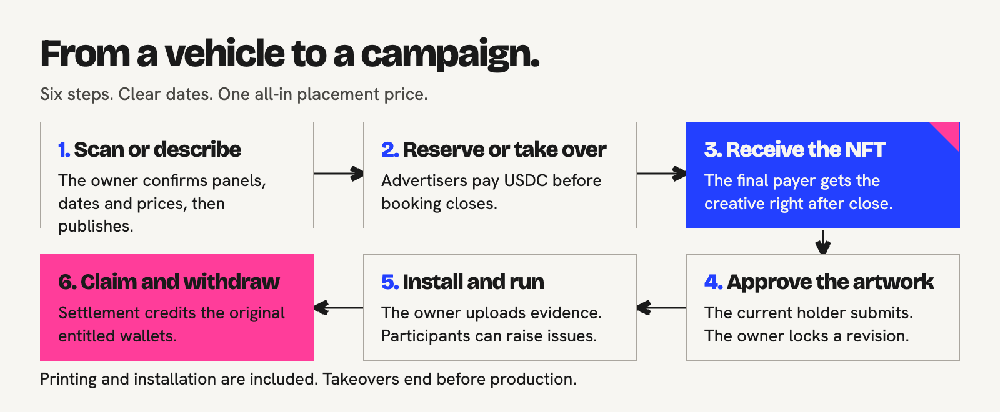
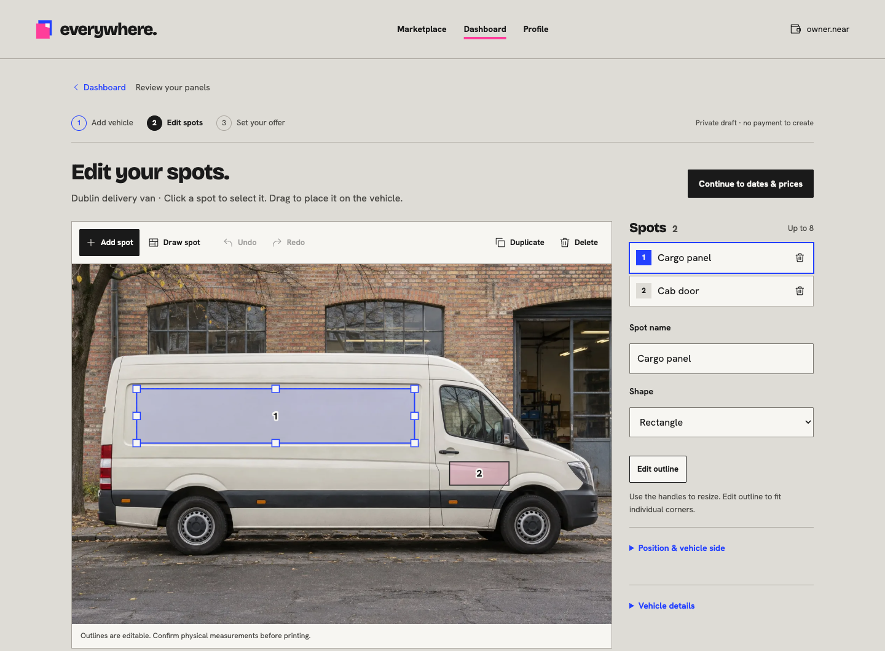
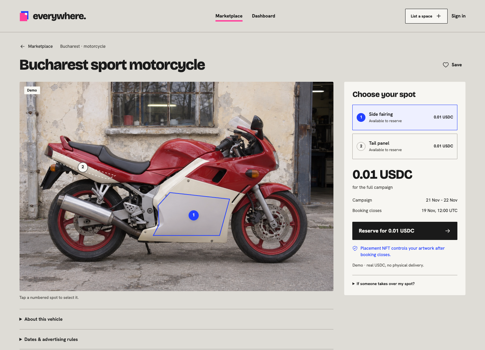
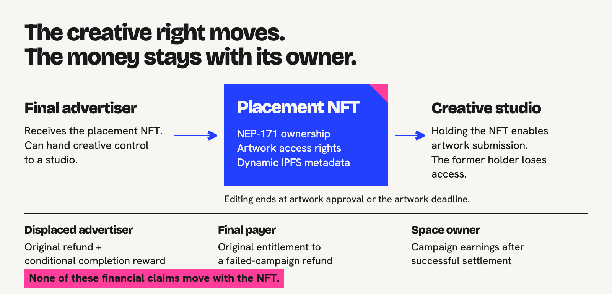

# User flow

[Overview](../README.md) | [Project brief](PROJECT-BRIEF.md) | [Architecture](TECHNICAL-ARCHITECTURE.md) | [Contracts](CONTRACTS.md) | [Verify](../VERIFY.md) | [Docs](README.md)

The platform has three main destinations: **Marketplace** for discovery and booking, **Dashboard** for listing space, and **Profile** for a wallet's bookings, NFTs, saved spaces and money. A first-time owner is prompted to create a first campaign rather than navigate an empty admin console.

## Space owner

1. **Start a vehicle.** Open [photo setup](https://everywhere-near.vercel.app/host/assets/new?mode=photo), send a photo through the private phone-capture link, or [describe a vehicle](https://everywhere-near.vercel.app/host/assets/new?mode=describe). Sign in with a supported wallet. A description can generate a labelled reference image.
2. **Review the spots.** AI proposes visible panel outlines. Click a spot to edit its name or shape, drag it, resize it, or edit individual corners. Draw and duplicate spots; Delete/Backspace remove a selected spot outside text fields, and Undo/Redo recover changes. The owner confirms dimensions before production.
3. **Set the offer.** Choose the operating area, fixed campaign dates and prices including printing/installation. Set a sale-wide takeover default and per-spot overrides. Private vehicle and campaign drafts allocate no NEAR.
4. **Publish.** Review the committed terms and approve the required wallet action. Each placement is independently bound to an offer in the shared hub. Complimentary publication depends on the actual sponsor pool and configured limits; paid publication is not universally free.
5. **Manage delivery.** The dashboard shows the next relevant action. Approve the exact artwork revision, arrange printing and installation, then upload evidence before the relevant deadlines.
6. **Receive earnings.** After service and issue review close, successful fulfillment permits settlement. Claim available earnings and withdraw through the supported wallet path. Unused offer reserves can be reclaimed by their original funder after all obligations settle.

*Editor capture uses the real built interface and an isolated API fixture. It is not evidence of a paid inference or publication.*

## Advertiser

1. **Find a vehicle.** Browse [Marketplace](https://everywhere-near.vercel.app/explore), choose a vehicle and select a placement directly on its photo or in its placement list. Dates, the all-in price and booking/takeover availability belong to that specific offer.
2. **Book under published rules.** Connect a wallet, choose an existing buyer campaign or create one, acknowledge the rules, and review the payment. Immediate booking does not require prior owner approval; artwork is reviewed later.
3. **Fund or pay.** The available flow uses wallet-approved USDC and signed actions. A Base route requires an actual quote and may include routing costs; the displayed placement price is not a promise of zero bridge cost. Sign-in alone never authorizes spending.
4. **Follow the booking.** Profile retains the booking and operation status. One campaign can contain placements across multiple owners, with independent terms and payments.
5. **After booking closes.** The final payer receives the NFT directly, including an EVM payer. Submit artwork or transfer creative control to a studio during the editing window.
6. **Review delivery and money.** Inspect owner-submitted evidence, raise an issue when appropriate, and claim any original-wallet refund/reward. Settlement and withdrawal follow the recorded creditor and original operation.

*Public team-test listing. The generated reference image is not installation evidence, and its payments use real USDC.*

## Creative studio / NFT recipient

The current holder sees the placement under the wallet's placement rights. Transferring the NFT grants artwork authority to the new holder and removes it from the former holder. A studio can submit or revise artwork before owner approval or the artwork deadline. Each accepted revision changes the NFT metadata reference and hash.

Approval fixes an exact revision for production. The deadline independently ends editing. A later archival transfer does not reopen that window. Refunds, conditional takeover rewards and owner earnings do not follow the NFT. [Exact rules and tests](CONTRACTS.md#nft-authority).

## Campaign arbiter

Participants can raise an on-chain issue during the permitted window. An unresolved issue blocks automatic success. The campaign's designated, separate arbiter reviews the evidence and signs its decision. Successful settlement still requires the service/review and fulfillment gates. Failure settlement produces the applicable original-payer refunds.

An evidence hash confirms which bytes were submitted; the arbiter still needs human judgment about whether those bytes establish physical delivery.

## Rejection and recovery

| Situation | Platform behavior |
| --- | --- |
| Wallet request rejected before sending | No successful action is invented; the user can retry from the appropriate state. |
| Send response lost, page reloaded or API restarted | The durable journal reconciles the original operation before offering a new transfer. |
| A different wallet connects | Sessions, placement authority and financial credits follow the connected identity. |
| NFT transferred away | Former-holder artwork actions are rejected by the hub; financial credits remain unchanged. |
| Provider check unavailable | The UI retains the distinction between recorded data, unavailable state and verified current state. |
| Media/AI provider unavailable | Manual editing remains usable; interrupted inference is not automatically retried as a second paid job. |

The [real Sandbox interface scenario](../prototype/tests/production-browser.mjs) covers the lifecycle with genuine signatures, actual contract execution, injected wallet UI and synthetic media transport. It also tests a former holder's direct signed request against a matching successful request from the current holder. [Coverage and limits](../VERIFY.md#full-interface-on-a-local-chain).
